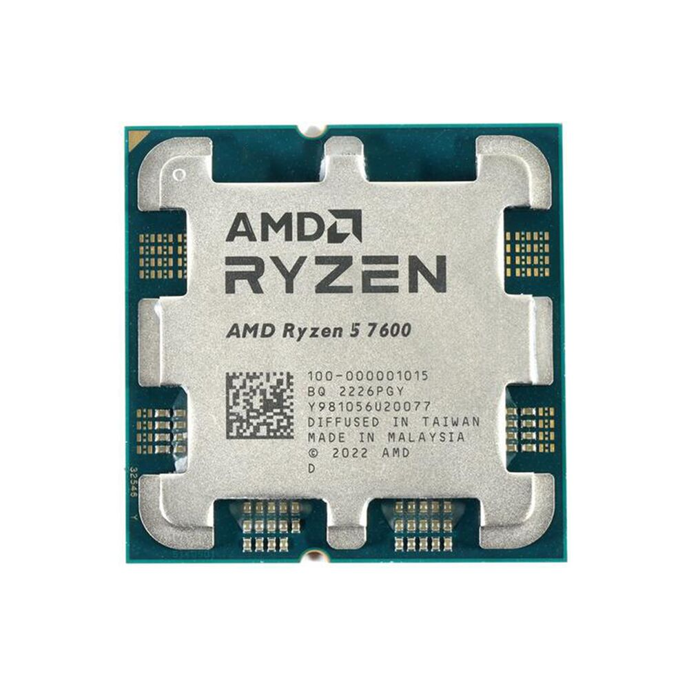
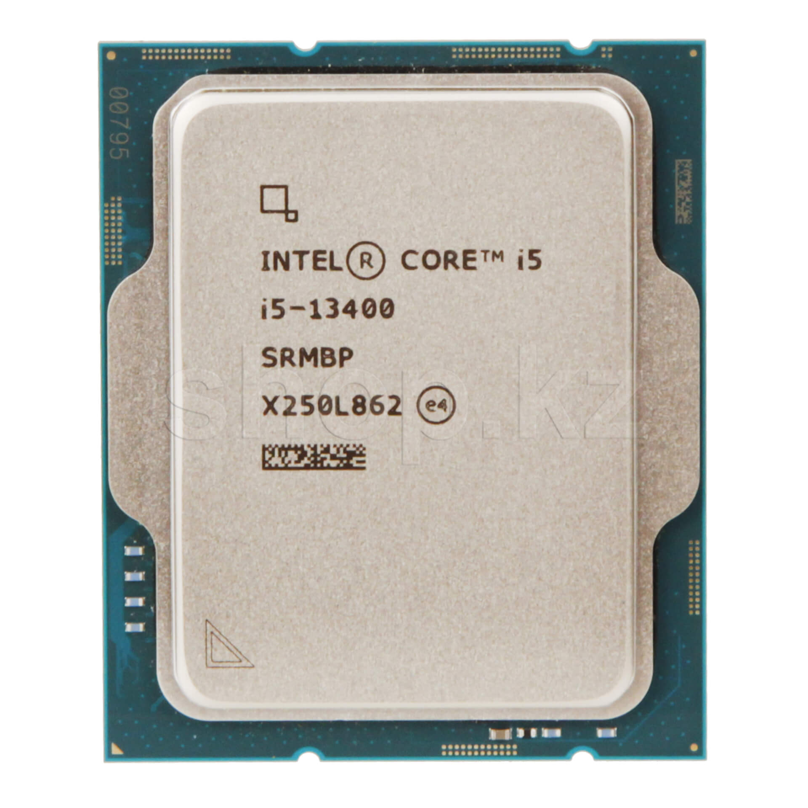
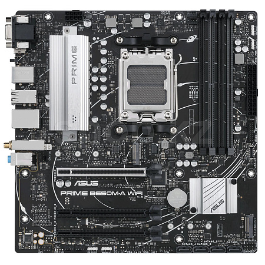
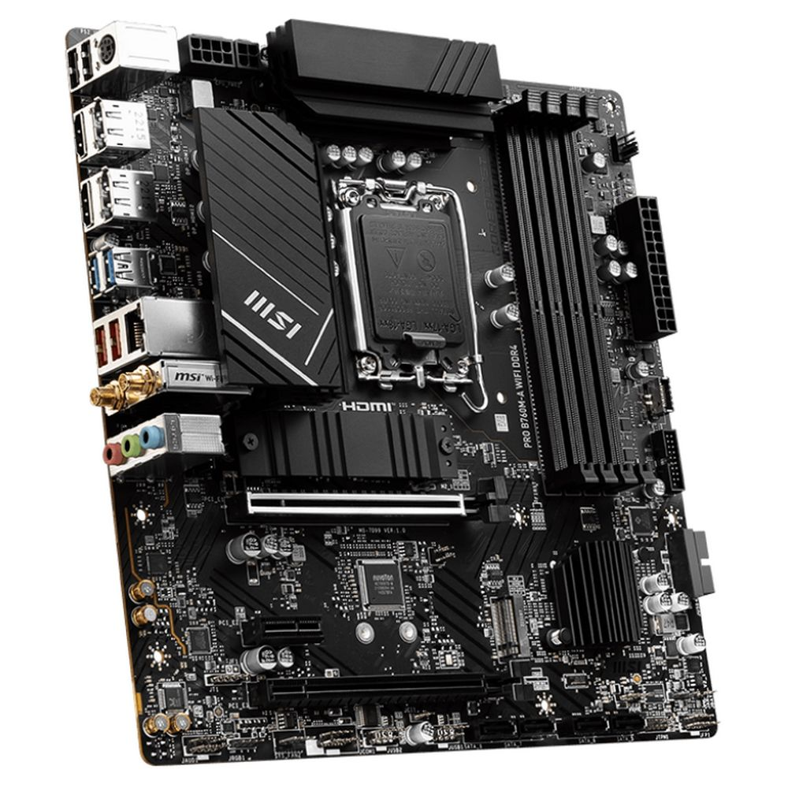
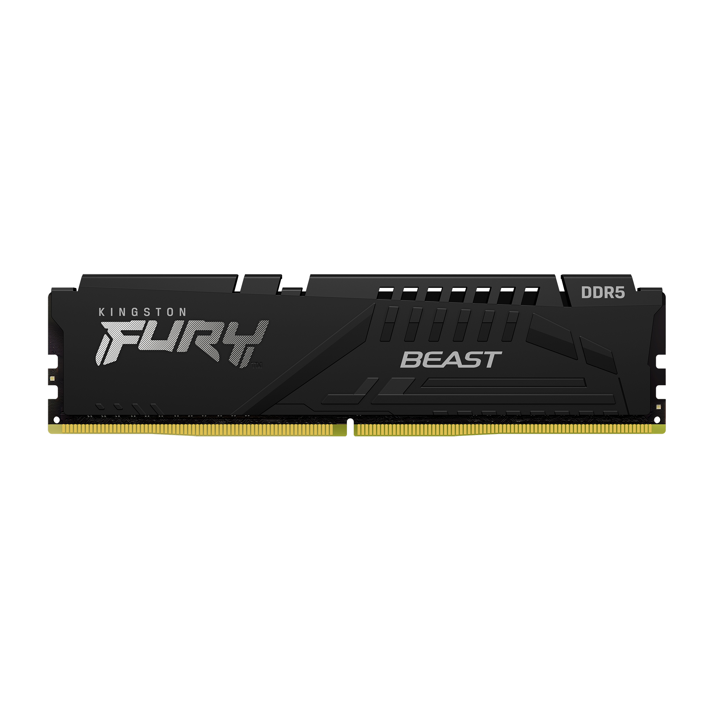
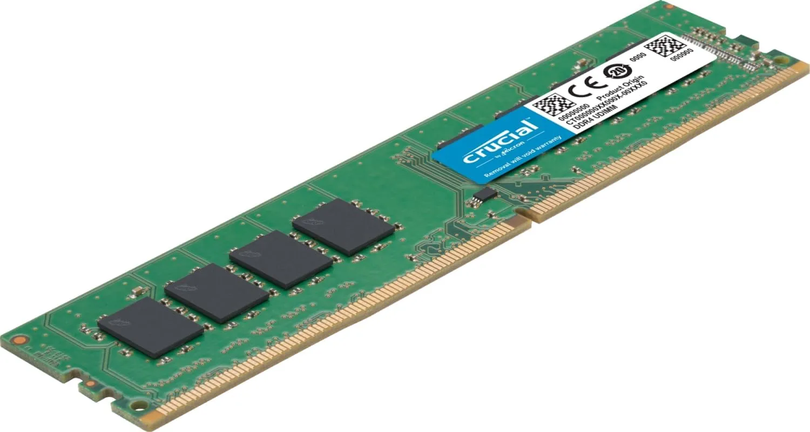
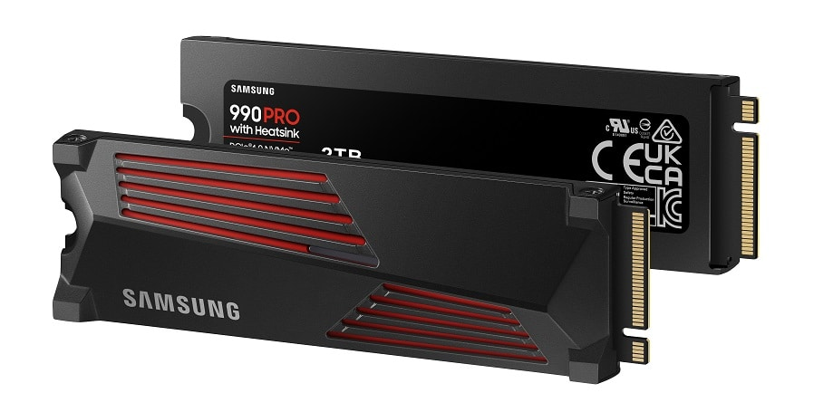
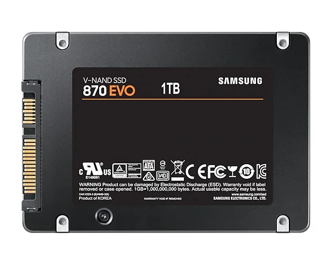
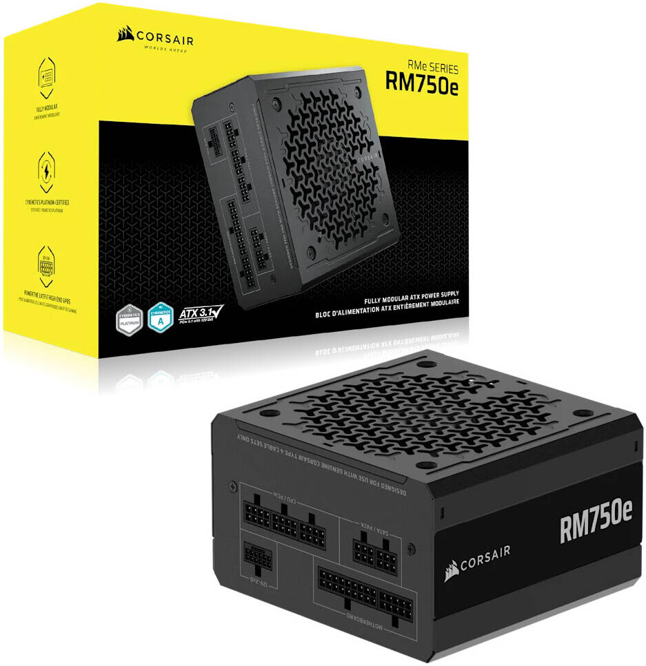
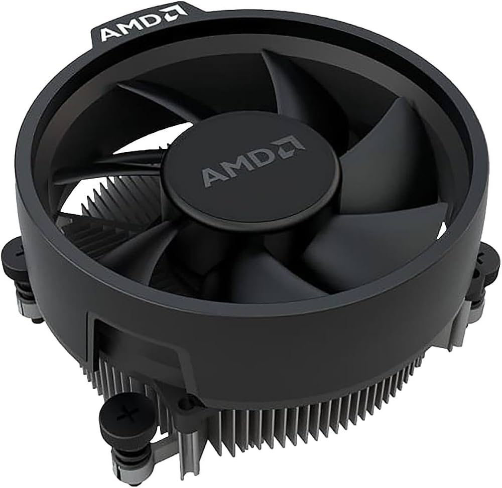

# Lab 3 — Teardown, and the Same Machine from the Command Line
## Part 1: Teardown on Paper
1. Processors
AMD Ryzen 5 7600

Type: Desktop CPU.
Socket: AM5.
Cores/Threads: 6 cores / 12 threads.
Base clock: 3.8 GHz.
Maximum boost clock: 5.1 GHz.
TDP: 65 W.
Connection: Installs into an AM5 motherboard socket and communicates with RAM, storage and expansion devices through the motherboard.
Limitation: Requires an AM5 motherboard and DDR5 memory. It cannot be installed in an Intel LGA1700 motherboard.
Cooling: AMD Wraith Stealth stock cooler is specified for the boxed processor.

Manufacturer: https://www.amd.com/en/products/processors/desktops/ryzen/7000-series/amd-ryzen-5-7600.html

Intel Core i5-13400

Type: Desktop CPU.
Socket: LGA1700.
Cores/Threads: 10 cores / 16 threads.
Maximum turbo frequency: 4.6 GHz.
Processor base power: 65 W.
Maximum turbo power: 148 W.
Connection: Installs into an LGA1700 motherboard socket.
Limitation: Requires a compatible LGA1700 motherboard. Memory type depends on the motherboard: DDR4 or DDR5.
Cooling: The boxed version includes the Intel Laminar RM1 cooler.

Manufacturer: https://www.intel.com/content/www/us/en/products/sku/230495/intel-core-i513400-processor-20m-cache-up-to-4-60-ghz/specifications.html

2. Motherboards
ASUS PRIME B650M-A

Type: Micro-ATX motherboard.
Socket: AM5.
Chipset: AMD B650.
Memory: DDR5, 4 DIMM slots.
CPU compatibility: AMD Ryzen 7000, 8000 and 9000 series, according to the manufacturer's supported CPU list.
Connection: Connects the processor, DDR5 RAM, M.2 SSDs, SATA drives, graphics cards and other components.
Limitation: Supports DDR5 only. It cannot accept Intel processors or DDR4 memory.

Manufacturer specifications: https://www.asus.com/motherboards-components/motherboards/prime/prime-b650m-a/techspec/

CPU support list: https://www.asus.com/motherboards-components/motherboards/prime/prime-b650m-a/helpdesk_qvl_cpu/

MSI PRO B760M-A WIFI DDR4

Type: Micro-ATX motherboard.
Socket: LGA1700.
Chipset: Intel B760.
Memory: DDR4, 4 DIMM slots, up to 128 GB.
CPU compatibility: Intel Core 12th, 13th and 14th generations, Pentium Gold and Celeron processors.
Connection: Connects the Intel CPU, DDR4 RAM, M.2 SSDs, SATA drives and PCIe expansion cards.
Limitation: Supports DDR4 only. DDR5 memory cannot be installed.

Manufacturer specifications: https://www.msi.com/Motherboard/PRO-B760M-A-WIFI-DDR4/Specification

CPU support: https://www.msi.com/Motherboard/PRO-B760M-A-WIFI-DDR4/support

3. Memory
Kingston FURY Beast DDR5-5600, 16 GB

Type: DDR5 desktop memory.
Capacity: 16 GB.
Speed: 5600 MT/s.
Connection: Installs into a 288-pin DDR5 DIMM slot on a compatible motherboard.
Limitation: Only compatible with DDR5 motherboards. It cannot be installed in a DDR4 slot.

Manufacturer: https://www.kingston.com/ru/memory/gaming/kingston-fury-beast-ddr5-memory

Crucial DDR4-3200, 16 GB DIMM

Type: DDR4 desktop memory.
Capacity: 16 GB.
Speed: 3200 MT/s.
Connection: Installs into a 288-pin DDR4 DIMM motherboard slot.
Limitation: Only compatible with DDR4 motherboards. It is not compatible with DDR5 slots.

Manufacturer: https://www.crucial.com/

4. Storage Devices
Samsung 990 PRO 1 TB

Type: NVMe solid-state drive.
Capacity: 1 TB.
Form factor: M.2 2280.
Interface: PCIe 4.0 x4, NVMe 2.0.
Sequential read speed: Up to 7450 MB/s.
Connection: Installs into a compatible M.2 M-key PCIe slot on the motherboard.
Limitation: Requires a compatible M.2 PCIe slot. Maximum speed depends on the motherboard and PCIe generation.

Manufacturer: https://www.samsung.com/uk/memory-storage/nvme-ssd/990-pro-1tb-nvme-pcie-gen-4-mz-v9p1t0bw/

Samsung 870 EVO 1 TB

Type: SATA solid-state drive.
Capacity: 1 TB.
Form factor: 2.5 inches.
Interface: SATA 6 Gb/s.
Sequential read speed: Up to 560 MB/s.
Connection: Connects to a motherboard SATA data port and the power supply using a SATA power connector.
Limitation: Slower than NVMe PCIe SSDs and requires a SATA connection.

Manufacturer: https://www.samsung.com/us/business/support/owners/product/870-evo-series-1tb/

5. Power Supply and Cooling
Corsair RM750e (750 W)

Type: ATX power supply unit.
Power output: 750 W.
Efficiency: 80 PLUS Gold.
Connection: Supplies power to the motherboard, CPU, graphics card and storage devices through ATX, EPS, PCIe and SATA power connectors.
Limitation: The power supply must fit the computer case and provide sufficient wattage and connectors for all components.

Manufacturer: https://www.corsair.com/us/en/p/psu/cp-9020262-na/rme-series-rm750e-fully-modular-low-noise-atx-power-supply-cp-9020262-na

Stock CPU Cooler

Type: Air CPU cooler.
Model: AMD Wraith Stealth.
Connection: Attaches to the AM5 CPU mounting system and connects its fan cable to the motherboard CPU_FAN header.
Purpose: Transfers heat away from the processor.
Limitation: Designed for processors with relatively moderate thermal requirements. More powerful processors may require a better cooling solution.

The Ryzen 5 7600 includes the Wraith Stealth cooler in its boxed package.

The boxed Intel Core i5-13400 includes the Intel Laminar RM1 cooler.

Manufacturer references: https://www.amd.com/en/products/processors/desktops/ryzen/7000-series/amd-ryzen-5-7600.html

https://www.intel.com/content/www/us/en/support/articles/000089190/processors/intel-core-processors.html

## Part 2: Two Working Computer Builds
Build 1 — AMD System
Component	Model	Reason
CPU	AMD Ryzen 5 7600	AM5 processor supported by the motherboard
Motherboard	ASUS PRIME B650M-A	AM5 socket and B650 chipset
RAM	Kingston FURY Beast DDR5-5600 16 GB	Compatible DDR5 memory
SSD	Samsung 990 PRO 1 TB	Compatible M.2 PCIe NVMe storage
PSU	Corsair RM750e 750 W	Provides power to the system
Cooler	AMD Wraith Stealth	Stock cooler for the Ryzen 5 7600

Additional components required:

Micro-ATX compatible computer case.
Monitor, keyboard and mouse.
Additional graphics card if more graphics performance is required.

The Ryzen 5 7600 has integrated Radeon graphics, so a dedicated GPU is not required for basic display output.

Build 2 — Intel System
Component	Model	Reason
CPU	Intel Core i5-13400	Compatible with LGA1700
Motherboard	MSI PRO B760M-A WIFI DDR4	Supports Intel 12th, 13th and 14th generation CPUs
RAM	Crucial DDR4-3200 16 GB	Compatible DDR4 memory
SSD	Samsung 870 EVO 1 TB	Compatible SATA storage
PSU	Additional 750 W ATX PSU required	The listed Corsair PSU is assigned to Build 1
Cooler	Intel Laminar RM1	Included with boxed i5-13400

Additional components required:

Micro-ATX compatible computer case.
Second ATX power supply.
Monitor, keyboard and mouse.
Additional graphics card if more graphics performance is required.

The Intel Core i5-13400 includes Intel UHD Graphics 730, so a dedicated graphics card is not required for basic display output.

## Part 3: Reading Hardware Specifications from the Command Line

The goal is to obtain processor, memory and storage information using commands in different operating systems.

Operating System Command Table
Hardware information	Windows PowerShell	Linux	macOS
CPU model	Get-CimInstance Win32_Processor | Select-Object Name	lscpu	sysctl -n machdep.cpu.brand_string
CPU cores	Get-CimInstance Win32_Processor | Select-Object NumberOfCores	lscpu	sysctl -n hw.physicalcpu
CPU threads	Get-CimInstance Win32_Processor | Select-Object NumberOfLogicalProcessors	nproc	sysctl -n hw.logicalcpu
RAM information	Get-CimInstance Win32_PhysicalMemory	sudo dmidecode -t memory	system_profiler SPMemoryDataType
RAM total	Get-CimInstance Win32_ComputerSystem | Select-Object TotalPhysicalMemory	free -h	sysctl -n hw.memsize
Disk model	Get-CimInstance Win32_DiskDrive	lsblk -o NAME,MODEL,SIZE,TYPE	system_profiler SPNVMeDataType SPSerialATADataType
Disk capacity	Get-Disk	lsblk	diskutil list
Important Note About Linux Virtual Machines

If Linux is running inside a virtual machine, the commands describe the virtual hardware presented to the guest operating system, not necessarily the physical computer's actual processor, RAM or disk.

## What did not work the first time

My laptop runs Windows as its main operating system, and I use a Linux virtual machine to demonstrate Linux commands and system specifications.

I was unable to demonstrate the macOS commands directly because I do not have enough free storage space on my laptop to install an additional macOS virtual machine. Most of the available storage is already being used by the Linux virtual machine.

## Evidence Files

Save the actual command output in these files:

evidence/windows-specs.txt
evidence/linux-specs.txt
evidence/macos-specs.txt (if a Mac is available)

The output must be generated on the actual machines.

## Conclusion

This lab demonstrates how computer hardware components connect and how compatibility depends on sockets, chipsets, memory generations and storage interfaces.

Two compatible computer configurations were designed using the provided components.

The command-line section demonstrates how Windows, Linux and macOS report CPU, memory and storage specifications using different system utilities.

The collected outputs are stored in the evidence directory.
